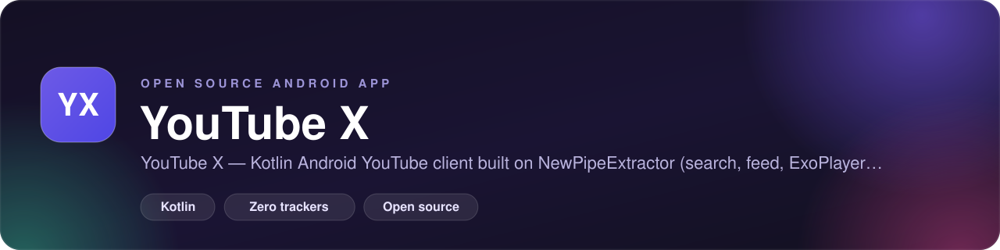

<div align="center">



<a href="https://github.com/technicalnihilist-lgtm/youtube-x/stargazers"></a>&nbsp;<a href="https://github.com/technicalnihilist-lgtm/youtube-x/network/members"></a>

<a href="https://github.com/technicalnihilist-lgtm/youtube-x/releases/latest/download/YouTubeX-1.8-debug.apk"></a> <a href="https://technicalnihilist-lgtm.github.io/apps-site/apps/youtube-x.html"></a>

<b>Support the work</b>

  

<sub>Donations aren't live yet — Paytm, UPI, PayPal and Buy&nbsp;Me&nbsp;a&nbsp;Coffee all show <b>coming soon</b>. Until then, a ⭐ star is the best support.</sub>

<a href="https://github.com/technicalnihilist-lgtm/youtube-x/releases/latest"></a>  <a href="https://github.com/technicalnihilist-lgtm/youtube-x/releases"></a>

</div>

---

## Screenshots


## Download APK

**[YouTubeX-1.8-debug.apk](https://github.com/technicalnihilist-lgtm/youtube-x/releases/latest)** — 12.3 MB

Install: APK phone me copy karo → file manager se kholo → "unknown sources" allow karo → Install.
Package `com.youtubex.app`, version 1.8 (versionCode 9), **minSdk 26** (Android 8.0+).
Icon ya poster update hone par purana app **uninstall karke** fresh install karo.

APK debug-signed hai — apne phone par test karne ke liye theek, Play Store ke liye apna release
keystore chahiye.

## Features

| Screen | Kya hota hai |
| --- | --- |
| Splash | Sirf “YouTube X” text, squash-and-hop bounce, ~0.8s baad fade out |
| Home | Feed (pehla working kiosk, warna search fallback), chips se category filter |
| Explore | Anime / Cartoon / Movies / Music / Gaming / Tech ke horizontal carousels |
| Subs | Subscribe kiye channels ka grid + latest videos (on-device) |
| Search | Full-screen glass search bar + YouTube autocomplete chips |
| Player | Rounded 16:9 ExoPlayer + glass sheet: Like, Save, Channel, Comments, YouTube, Close |
| Sheets | Channel, Comments, Library (history/liked/later/What's new), Settings |
| Settings | Theme, glass transparency, loop, 4D depth, depth intensity, bounce, macOS animations |

Stream chunne ka order: progressive (video+audio) → HLS → DASH. 1.5 poster app ke andar hai
(`drawable-nodpi/poster_1_5.webp`) aur You → “What's new” sheet me dikhta hai.

## Build

1. Android Studio (Ladybug ya naya) → **Open** → ye folder. JDK 17 + Android SDK 34 chahiye.
2. Gradle sync hone do, phir Run.

Do choti baatein:

- `gradle/wrapper/gradle-wrapper.jar` aur `gradlew` scripts repo me commit nahi hain (binary).
  Release me **YouTubeX-android-project.zip** attached hai jisme poora project (wrapper + prebuilt
  jars) hai — wahi use karna sabse aasan hai. Ya phir `gradle wrapper --gradle-version 8.9` chala lo.
- `app/build.gradle.kts` me NewPipeExtractor JitPack se aata hai
  (`implementation("com.github.teamnewpipe:NewPipeExtractor:v0.26.5")`). Offline build ke liye
  release zip me `app/libs/` ke prebuilt jars hain.

## Structure

```
app/src/main/java/com/youtubex/app/
├── MainActivity.kt            splash + chips + feed + explore + subs + dock + search + sheets
├── PlayerActivity.kt          ExoPlayer playback screen (glass sheet + actions)
├── YtApp.kt                   theme (AppCompatDelegate) boot
├── data/DownloaderImpl.kt     NewPipeExtractor ka network layer (HttpURLConnection)
├── data/YtClient.kt           wrapper: search(), trending(), playable(), channel(), comments()
├── data/Prefs.kt              history / liked / later / subs / settings (SharedPreferences)
├── model/VideoItem.kt         VideoItem / Playable / SourceKind
├── ui/VideoAdapter.kt         card adapter + 4D depth tilt
├── ui/Ui.kt                   glass sheet show/hide (bounce & macOS), rows, toast
└── util/Formats.kt            duration / views formatting

app/src/main/res/
├── anim/splash_bounce.xml     splash ka squash-and-hop bounce
├── mipmap-*dpi/               icon (ic_launcher, ic_launcher_round, ic_launcher_foreground)
├── mipmap-anydpi-v26/         adaptive icon (art 58% safe zone me)
└── drawable-nodpi/            poster_1_5.webp
```

## Changelog

**v1.8** — naya splash: sirf “YouTube X”, bounce karta hua; logo mark, poster aur loader hata diye

**v1.7** — icon size fix (art launcher ke safe zone me)

**v1.6** — naya icon (glossy black/red) + 1.5 poster APK ke andar

**v1.5** — icon (YouTube screen + play mark + “YouTube X”), tilt/scale leak fix

**v1.4** — 4D depth effect + depth slider + bounce/macOS sheet animations

**v1.3** — poora shell: splash, Explore carousels, Subs grid, channel/comments/library sheets,
settings, player actions, search suggestions, toasts

**v1.2** — liquid-glass UI (cards, chips, dock, glass sheets)

**v1.1** — feed fix (default YouTube kiosk `live` NPE)

**v1.0** — pehla build

## Notes

- APK debug-signed hai; screenshots real device se hain.
- Glass effect native drawables se bana hai (real backdrop blur / SVG refraction nahi).
- YouTube kabhi kabhi stream URL par 403 deta hai (throttling); tab app error dikhata hai aur
  "YouTube par kholo" button kaam aata hai.
- Age-restricted / members-only / login maangne wale videos nahi chalenge.
- NewPipeExtractor **GPL-3.0** hai, isliye ye project bhi GPL-3.0 hai. YouTube ke Terms of Service ka
  khayal rakho — personal use theek hai, Play Store publish risky hai.

---

## 🌍 Languages

<sub>Donations are <b>coming soon</b> in every language below — nothing to pay today, nothing to click.</sub>

<div align="center">

<sub><b>हिन्दी · বাংলা · मराठी · తెలుగు · தமிழ் · ગુજરાતી · ಕನ್ನಡ · മലയാളം · ਪੰਜਾਬੀ · ଓଡ଼ିଆ · অসমীয়া · اردو</b></sub>

</div>

<details>
<summary><b>🌍 Open the same message in 53 languages</b></summary>

**🇮🇳 Indian languages**

- **हिन्दी** (Hindi) — ☕ जल्द ही आ रहा है। · ⭐ अगर आपको यह ऐप और हमारा काम पसंद है, तो कृपया रिपॉजिटरी को स्टार दें और हमें फॉलो करें।
- **বাংলা** (Bengali) — ☕ খুব শিগগিরই আসছে। · ⭐ যদি আপনার এই অ্যাপ এবং আমাদের কাজ ভালো লাগে, তবে অনুগ্রহ করে রিপোজিটরিটিকে একটি স্টার দিন এবং আমাদের ফলো করুন।
- **मराठी** (Marathi) — ☕ लवकरच येत आहे. · ⭐ जर तुम्हाला हे ॲप आणि आमचं काम आवडलं असेल, तर कृपया रिपॉझिटरीला स्टार द्या आणि आम्हाला फॉलो करा.
- **తెలుగు** (Telugu) — ☕ త్వరలో రాబోతోంది. · ⭐ మీకు ఈ యాప్, మా పని నచ్చితే, దయచేసి రిపోజిటరీకి ఒక స్టార్ ఇచ్చి మమ్మల్ని ఫాలో అవ్వండి.
- **தமிழ்** (Tamil) — ☕ விரைவில் வருகிறது. · ⭐ உங்களுக்கு இந்த ஆப்பும் எங்க வேலையும் பிடிச்சிருந்தா, தயவுசெஞ்சு இந்த ரெபாசிட்டரிக்கு ஒரு ஸ்டார்…
- **ગુજરાતી** (Gujarati) — ☕ ટૂંક સમયમાં આવી રહ્યું છે. · ⭐ જો તમને આ એપ અને અમારું કામ ગમતું હોય, તો પ્લીઝ રિપોઝિટરીને સ્ટાર આપો અને અમને ફોલો કરો.
- **ಕನ್ನಡ** (Kannada) — ☕ ಶೀಘ್ರದಲ್ಲೇ ಬರುತ್ತಿದೆ. · ⭐ ನಿಮಗೆ ಈ ಆ್ಯಪ್ ಮತ್ತು ನಮ್ಮ ಕೆಲಸ ಇಷ್ಟವಾದರೆ, ದಯವಿಟ್ಟು ರೆಪೊಸಿಟರಿಗೆ ಸ್ಟಾರ್ ಕೊಡಿ ಮತ್ತು ನಮ್ಮನ್ನು ಫಾಲೋ ಮಾಡಿ.
- **മലയാളം** (Malayalam) — ☕ ഉടൻ വരുന്നു. · ⭐ നിങ്ങൾക്ക് ഈ ആപ്പും ഞങ്ങളുടെ പ്രവർത്തനവും ഇഷ്ടപ്പെട്ടെങ്കിൽ, ദയവായി റെപ്പോസിറ്ററിക്ക് ഒരു സ്റ്റാർ…
- **ਪੰਜਾਬੀ** (Punjabi) — ☕ ਜਲਦੀ ਆ ਰਿਹਾ ਹੈ। · ⭐ ਜੇ ਤੁਹਾਨੂੰ ਇਹ ਐਪ ਅਤੇ ਸਾਡਾ ਕੰਮ ਪਸੰਦ ਹੈ, ਤਾਂ ਕਿਰਪਾ ਕਰਕੇ ਰਿਪੋਜ਼ਟਰੀ ਨੂੰ ਸਟਾਰ ਦਿਓ ਅਤੇ ਸਾਨੂੰ ਫਾਲੋ ਕਰੋ।
- **ଓଡ଼ିଆ** (Odia) — ☕ ଖୁବ୍ ଶୀଘ୍ର ଆସୁଛି। · ⭐ ଯଦି ଆପଣଙ୍କୁ ଏହି ଆପ୍ ଏବଂ ଆମର କାମ ଭଲ ଲାଗୁଛି, ତେବେ ଦୟାକରି ରିପୋଜିଟୋରୀକୁ ଗୋଟିଏ ଷ୍ଟାର୍ ଦିଅନ୍ତୁ ଏବଂ ଆମକୁ ଫଲୋ କରନ୍ତୁ।
- **অসমীয়া** (Assamese) — ☕ অতি সোনকালেই আহি আছে। · ⭐ যদি আপুনি এই এপটো আৰু আমাৰ কাম ভাল পায়, তেন্তে অনুগ্ৰহ কৰি ৰিপজিটৰীটোক এটা ষ্টাৰ দিয়ক আৰু আমাক ফ'ল' কৰক।
- **اردو** (Urdu) — ☕ جلد آرہا ہے۔ · ⭐ اگر آپ کو یہ ایپ اور ہمارا کام پسند آئے تو براہ کرم ریپازٹری کو سٹار دیں اور ہمیں فالو کریں۔
- **संस्कृतम्** (Sanskrit) — ☕ शीघ्रमेव आगच्छति।
- **मैथिली** (Maithili) — ☕ जल्दिये आबि रहल अछि।
- **कोंकणी** (Konkani) — ☕ रोखडेंच येता.
- **کٲشُر** (Kashmiri) — ☕ جَلدی یِوان چھُ۔
- **سنڌي** (Sindhi) — ☕ जल्द अची रह्यो आहे।
- **डोगरी** (Dogri) — ☕ जल्दी आ करदा ऐ।
- **ꯃꯤꯇꯩ ꯂꯣꯟ** (Manipuri) — ☕ ꯑꯊꯨꯕꯥ ꯃꯇꯝꯗꯥ ꯂꯥꯛꯀꯅꯤ꯫
- **बर’** (Bodo) — ☕ थाबैनो फैगोन।
- **ᱥᱟᱱᱛᱟᱲᱤ** (Santali) — ☕ ᱞᱚᱜᱚᱱ ᱦᱤᱡᱩᱜ ᱠᱟᱱᱟ᱾
- **नेपाली** (Nepali) — ☕ छिट्टै आउँदैछ। · ⭐ यदि तपाईंलाई यो एप र हाम्रो काम मन पर्‍यो भने, कृपया रिपोजिटरीलाई स्टार दिनुहोस् र हामीलाई फलो गर्नुहोस्।

**🌍 World languages**

- **العربية** (Arabic) — ☕ قريبًا. · ⭐ إذا أعجبك هذا التطبيق وعملنا، فيرجى منح المستودع نجمة ومتابعتنا.
- **简体中文** (Chinese (Simplified)) — ☕ 即将推出。
- **繁體中文** (Chinese (Traditional)) — ☕ 即將推出。
- **Čeština** (Czech) — ☕ Již brzy.
- **Dansk** (Danish) — ☕ Kommer snart.
- **Nederlands** (Dutch) — ☕ Binnenkort beschikbaar. · ⭐ Vind je deze app en ons werk leuk?
- **Filipino** (Filipino) — ☕ Malapit na.
- **Suomi** (Finnish) — ☕ Tulossa pian.
- **Français** (French) — ☕ Bientôt disponible. · ⭐ Si cette application et notre travail vous plaisent, mettez une étoile au dépôt et suivez-nous.
- **Deutsch** (German) — ☕ Bald verfügbar. · ⭐ Wenn dir diese App und unsere Arbeit gefallen, gib dem Repository einen Stern und folge uns.
- **Ελληνικά** (Greek) — ☕ Έρχεται σύντομα.
- **עברית** (Hebrew) — ☕ בקרוב.
- **Magyar** (Hungarian) — ☕ Hamarosan.
- **Bahasa Indonesia** (Indonesian) — ☕ Segera hadir. · ⭐ Jika kamu suka aplikasi ini dan karya kami, beri bintang pada repositori ini dan ikuti kami.
- **Italiano** (Italian) — ☕ In arrivo.
- **日本語** (Japanese) — ☕ 近日公開。 · ⭐ このアプリと私たちの仕事が気に入ったら、リポジトリにスターを付けてフォローしてください。
- **한국어** (Korean) — ☕ 곧 공개됩니다. · ⭐ 이 앱과 저희 작업이 마음에 드신다면 저장소에 스타를 눌러 주시고 팔로우해 주세요.
- **Bahasa Melayu** (Malay) — ☕ Akan datang.
- **Norsk** (Norwegian) — ☕ Kommer snart.
- **فارسی** (Persian) — ☕ به‌زودی.
- **Polski** (Polish) — ☕ Wkrótce. · ⭐ Jeśli podoba Ci się ta aplikacja i nasza praca, daj repozytorium gwiazdkę i obserwuj nas.
- **Português** (Portuguese) — ☕ Em breve.
- **Română** (Romanian) — ☕ În curând.
- **Русский** (Russian) — ☕ Скоро. · ⭐ Если вам нравится это приложение и наша работа, поставьте звёздочку репозиторию и подпишитесь на нас.
- **Español** (Spanish) — ☕ Muy pronto. · ⭐ Si te gusta esta app y nuestro trabajo, dale una estrella al repositorio y síguenos.
- **Kiswahili** (Swahili) — ☕ Inakuja hivi karibuni.
- **Svenska** (Swedish) — ☕ Kommer snart.
- **ไทย** (Thai) — ☕ เร็ว ๆ นี้
- **Türkçe** (Turkish) — ☕ Çok yakında.
- **Українська** (Ukrainian) — ☕ Незабаром.
- **Tiếng Việt** (Vietnamese) — ☕ Sắp ra mắt. · ⭐ Nếu bạn thích ứng dụng này và công việc của chúng tôi, hãy tặng kho lưu trữ một ngôi sao và theo…

</details>

